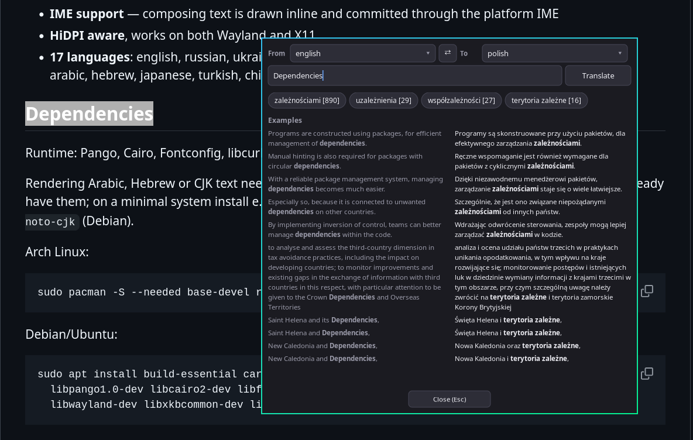

# Reverso Linux

A tiny, fast desktop translator for Linux, built on [Reverso](https://www.reverso.net).
It opens a small always-on-top window with the translation, frequency-ranked options,
and side-by-side usage examples.



## Why this stack?

The GUI is written in Rust with **winit** (window, input, IME, HiDPI),
**softbuffer** (CPU presentation over `wl_shm`/`XPutImage`, no OpenGL) and
**Pango/Cairo** (HarfBuzz shaping, FriBidi bidi, Fontconfig fallback).
There is no GTK, Qt, WebKit or Electron at runtime.

On the development machine this gives roughly **30 ms to first frame and 32 MB RSS**,
compared with ~53 ms / 34 MB for the old GTK3 build.

## Features

- **Persistent source & target language** — saved to `~/.config/reverso-linux/config`
- **Searchable language menu** — type to filter by name or code; `↑`/`↓` and `Enter` select
- **Translation options** for short text (1–3 words) with frequency counts
- **Usage examples** — mixed examples appear immediately when the response provides them; click a chip for option-specific examples
- **Full Unicode** — Arabic/Hebrew RTL and mixed-direction text, CJK, combining marks
- **IME support** — composing text is drawn inline and committed through the platform IME
- **HiDPI aware**, works on both Wayland and X11
- **17 languages**: english, russian, ukrainian, french, german, spanish, italian,
  portuguese, polish, dutch, arabic, hebrew, japanese, turkish, chinese, romanian, swedish

## Dependencies

Runtime: Pango, Cairo, Fontconfig, libcurl.

Rendering Arabic, Hebrew or CJK text needs the corresponding system fonts. Most
desktop installations already have them; on a minimal system install e.g.
`noto-fonts noto-fonts-cjk` (Arch) or `fonts-noto-core fonts-noto-cjk` (Debian).

Arch Linux:

```sh
sudo pacman -S --needed base-devel rust pango cairo curl
```

Debian/Ubuntu:

```sh
sudo apt install build-essential cargo pkg-config \
  libpango1.0-dev libcairo2-dev libfontconfig1-dev libcurl4-openssl-dev \
  libwayland-dev libxkbcommon-dev libx11-dev libxcb1-dev
```

## Build & Install

```sh
cargo build --release
sudo install -Dm755 target/release/reverso-linux /usr/local/bin/reverso-linux
```

To uninstall:

```sh
sudo rm /usr/local/bin/reverso-linux
```

The version string comes from `git describe --tags --match 'v*'`. When building
from a source tarball, set `APP_VERSION`:

```sh
APP_VERSION=x.y.z cargo build --release
```

## Usage

```sh
reverso-linux hello world             # translate arguments
wl-paste -p | reverso-linux           # translate the clipboard
reverso-linux -t french hello world   # set the target language
reverso-linux -h                      # help
reverso-linux -v                      # version
```

Keyboard and mouse:

- **Enter** — translate
- **Esc** — close (or dismiss the language dropdown)
- **Ctrl+A / C / V / X** — select all, copy, paste, cut
- Open a language menu and type to filter; **↑/↓** moves the highlight, **Enter** selects, **Esc** closes
- Click a translation chip to show its examples; click it again to return to the mixed view
- Mouse wheel — scroll the results and examples

If there is no text on stdin and no arguments, the program exits without opening a
window (matching the old CLI behaviour).

## Hyprland

Add to `~/.config/hypr/hyprland.conf`:

```
bind = SUPER, R, exec, wl-paste -p | reverso-linux

# Keep the popup floating and centered instead of tiling it.
windowrule = float on, match:class ^(reverso-linux)$
windowrule = center on, match:class ^(reverso-linux)$
```

Press **Win+R** to translate the current clipboard selection.

## Configuration

`~/.config/reverso-linux/config` (or `$XDG_CONFIG_HOME/reverso-linux/config`):

```
target_lang=russian
last_source_lang=english
```
